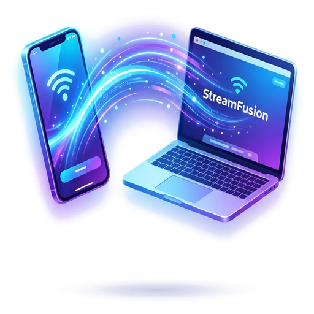

# 🚀 StreamFusion v3.1.2 — Next-Gen Android Mirroring & Wireless Control

<div align="center">



[](https://github.com/MilannSharma/StreamFusion/releases)
[](https://github.com/MilannSharma/StreamFusion)
[](https://github.com/Genymobile/scrcpy)
[](https://developer.android.com/tools/adb)
[](https://react.dev)
[](https://github.com/MilannSharma)

**StreamFusion v3.1.2** is an enterprise-grade, ultra-low latency desktop application for projecting, controlling, and managing Android smartphones on your Windows PC with zero perceptible lag. Built on top of **scrcpy v5.0.1**, **Google ADB v37.0.1**, **Electron**, and **React 19**.

[Download v3.1.2 Installer](https://github.com/MilannSharma/StreamFusion/releases) • [Features](#-key-features) • [Installation & Setup](#-installation--first-run-experience) • [Wi-Fi Auto-Reconnect](#-1-click-persistent-wi-fi-streaming) • [Brand Setup Guide](#-android-device-setup-guide-per-brand) • [Keyboard Shortcuts](#-keyboard--mouse-shortcuts)

</div>

---

## ✨ What's New in v3.0.0

* 🖤 **Cinematic Pitch-Black Welcome Experience**: Pure `#000000` canvas with a glowing white cursive "Welcome" vector line animation playing for the exact duration of the intro, smoothly dissolving into the main dashboard with hardware-accelerated cubic-bezier transitions. Window creation starts in black to completely eliminate startup white flash.
* 🐱 **In-Memory High-Performance Cat Playing Lottie**: Embedded directly as an in-memory JSON module (zero network requests, 0ms latency). Cleaned corrupted EOF bytes to ensure 100% reliable rendering on the Setup & Installation screen.
* ⚡ **Ultra-Compact Binary Size**: Shrunk installer down to **87.8 MB** (reduced from 333+ MB) and installed app to **261 MB** (reduced from 1.1+ GB) by stripping unnecessary runtime dependencies.
* 🛡️ **Hardened Local Security**: Express backend strictly bound to `127.0.0.1` with local-only host verification and media path validation. Private device configuration (`saved_devices.json`) is strictly gitignored.
* 📶 **1-Click Persistent Wi-Fi Auto-Reconnect**: Pair your phone once via USB. When you unplug the cable, StreamFusion remembers your phone! The next time your PC and phone are on the same Wi-Fi, your phone shows as **Online** with an instant **Mirror** button—no USB cable required!
* 🔋 **Smart Screen Stay-Awake & Double-Click Wake**: Automatically keeps your phone display awake during mirroring (`svc power stayon true`) and restores normal sleep behavior on disconnect (`svc power stayon false`). Double-clicking wakes up the screen via hardware `KEYCODE_WAKEUP`.
* 📦 **Pre-Built Windows Standalone Executables**: Available as an NSIS installer (`StreamFusion-v3.0.0-Setup.exe`).

---

## 📸 Key Features

### 1. 📱 Zero-Lag Screen Mirroring (USB & Wi-Fi)
- **High-Framerate 60–120 FPS**: Hardware-accelerated H.264/H.265 video pipeline with sub-30ms latency.
- **Auto-Minimize on Launch**: When screen mirroring begins, StreamFusion gently minimizes itself so your mobile display takes center stage.
- **Battery Saver Mode (`--turn-screen-off`)**: Keep phone hardware display turned off while streaming full resolution on your PC monitor to save battery and reduce heat.

### 2. 📶 1-Click Persistent Wi-Fi Streaming
- **Connect Once with USB**: Turn on Wi-Fi mode with one click.
- **Safe Cable Removal**: Unplug your USB cable anytime without interrupting your session.
- **Persistent Device Memory**: StreamFusion saves your phone's Wi-Fi IP and nickname locally. Even after restarting PC or disconnecting, simply open StreamFusion and click **Mirror** directly!

### 3. 🎙️ High-Fidelity Audio Forwarding (Android 11+)
- Direct internal audio routing from your smartphone into Windows speakers and headphones.
- Supports **Opus** (ultra-low latency ~15ms), **AAC** (crystal clarity), **FLAC** (lossless), and **RAW PCM**.
- Option for audio-only background streaming.

### 4. 📁 Drag & Drop File Transfer & Instant APK Push
- **Drop to Phone**: Drag pictures, music, documents, or videos directly onto the StreamFusion window—they are immediately pushed to your phone's `/sdcard/Download/` folder.
- **Drag & Drop APK Installation**: Drag any `.apk` file into the app to install it directly on your Android phone without opening settings.
- **Mobile File Browser**: Browse phone internal storage (`Downloads`, `DCIM`, `Pictures`, `Documents`) and download files to PC in one click.

### 5. ⚡ Virtual Navigation & Control Bar
- **Touch & Mouse Mapping**: Click, tap, scroll, pinch, and swipe naturally with your PC mouse or trackpad.
- **Direct PC Keyboard Typing**: Type in any language using your physical Windows keyboard.
- **Hardware Controls**: Dedicated buttons for `Back`, `Home`, `Recent Apps`, `Volume +/-`, `Power / Lock`, and `Wake Up`.
- **1-Click High-Res Screenshot**: Capture instantaneous mobile screenshots saved straight to `Pictures/StreamFusion`.

### 6. ⏺️ Screen Recording Studio
- Record high-bitrate sessions directly to **MP4** or **MKV**.
- Built-in video gallery to inspect recordings, preview file sizes, and open them in Windows Media Player or File Explorer.

---

## 🎨 Installation & First-Run Experience

StreamFusion v3.0.0 features an interactive setup modal designed for a clean experience:

1. **Embedded Lottie Cat Animation**: Engaging, cute cat animation welcoming you while background drivers initialize.
2. **Readiness Checkpoints**:
   - `✓ Google ADB Platform-Tools v37.0.1` (Verified & Active)
   - `✓ Scrcpy v5.0.1 Zero-Latency Codec Engine` (Configured)
   - `✓ 1-Click Wireless Wi-Fi Auto-Reconnect` (Persistence loaded)
   - `✓ Auto Screen Stay-Awake & Double-Click Wake` (Active)
3. **Replay Setup Tour**: You can revisit this setup screen anytime by going to the **Guide / FAQ** tab and clicking **Replay Setup Tour**.

---

## 🚀 Getting Started

### Option A: Install from Release Executable (Recommended)

1. Download **`StreamFusion-v3.0.0-Setup.exe`** from [Releases](https://github.com/MilannSharma/StreamFusion/releases).
2. Run the installer. It will:
   - Install StreamFusion into `C:\Program Files\StreamFusion v3.0.0`
   - Create Desktop & Start Menu shortcuts
   - Bundle all required `scrcpy` and `adb` drivers out-of-the-box (no manual installs needed)
3. Connect your Android phone via USB cable with **USB Debugging** enabled.
4. Click **▶ Start Mirror**!

### Option B: Run from Source (Developers)

```bash
# 1. Clone the repository
git clone https://github.com/MilannSharma/StreamFusion.git
cd StreamFusion

# 2. Install dependencies
npm install

# 3. Launch development server (Server + Vite + Electron)
npm run dev
```

---

## 📱 Android Device Setup Guide (Per Brand)

To allow your PC to mirror your phone, enable **Developer Options** and **USB Debugging**:

### 1. General Android (All Brands)
1. Open **Settings** > **About Phone**.
2. Tap **Build Number** 7 times continuously until it says *"You are now a developer!"*.
3. Go back to **Settings** > **System** (or **Additional Settings**) > **Developer Options**.
4. Turn ON **USB Debugging**.
5. When connecting the USB cable to PC, a prompt will appear on your phone screen: Check **"Always allow from this computer"** and tap **Allow**.

### 2. Vivo & iQOO (Funtouch OS / OriginOS)
1. Go to **Settings** > **About Phone** > **Software Information**.
2. Tap **Build Number** 7 times.
3. Go to **Settings** > **System** > **Developer Options**.
4. Enable **USB Debugging**.
5. Enable **USB Debugging (Security Settings)** if you want full mouse and keyboard control.

### 3. Xiaomi, Redmi & POCO (MIUI / HyperOS)
1. Open **Settings** > **About Phone** > Tap **OS Version / MIUI Version** 7 times.
2. Open **Additional Settings** > **Developer Options**.
3. Enable **USB Debugging**.
4. Enable **Install via USB**.
5. Enable **USB Debugging (Security settings)** *(Requires Xiaomi account sign-in)*.

### 4. Samsung Galaxy (One UI)
1. Open **Settings** > **About Phone** > **Software information**.
2. Tap **Build number** 7 times.
3. Return to **Settings** > **Developer options**.
4. Turn on **USB debugging**.

### 5. OnePlus, Realme & Oppo (OxygenOS / ColorOS / Realme UI)
1. Open **Settings** > **About device** > **Version**.
2. Tap **Version No.** 7 times.
3. Open **Settings** > **Additional Settings** > **Developer Options**.
4. Turn on **USB Debugging**.

---

## ⌨️ Keyboard & Mouse Shortcuts

When the mirroring window is active, you can control your phone with these shortcuts:

| Action | Shortcut / Mouse Gesture |
| :--- | :--- |
| **Wake Phone Display** | Double Click on Screen or `Alt` + `P` |
| **Toggle Fullscreen** | `Alt` + `F` |
| **Back Button** | `Alt` + `B` or Right-Click Mouse |
| **Home Screen** | `Alt` + `H` or Middle-Click Mouse |
| **Recent Apps (Switcher)** | `Alt` + `S` |
| **Turn Phone Screen Off (Keep Mirroring)** | `Alt` + `O` |
| **Turn Phone Screen On** | `Alt` + `Shift` + `O` |
| **Volume Up / Down** | `Alt` + `↑` / `Alt` + `↓` |
| **Pull Down Notifications** | `Alt` + `N` |
| **Expand Quick Settings** | `Alt` + `Shift` + `N` |
| **Copy Phone Clipboard to PC** | `Alt` + `C` |
| **Paste PC Clipboard to Phone** | `Ctrl` + `V` |
| **Install APK** | Drag `.apk` file into mirror window |
| **Push File to `/sdcard/Download/`** | Drag any file into mirror window |

---

## 🏗️ Project Architecture

```
StreamFusion/
├── electron/
│   ├── main.cjs               # Electron main process (window & lifecycle)
│   └── preload.cjs            # Secure IPC bridge
├── server/
│   └── index.js               # Express + WebSocket backend (manages scrcpy & adb)
├── src/
│   ├── App.tsx                # Main React 19 control hub & White Installer modal
│   ├── main.tsx               # Client entry point
│   ├── index.css              # Glassmorphic responsive styling
│   └── assets/                # In-memory verified Lottie animations
├── scrcpy-bin/                # Google ADB v37.0.1 & Scrcpy v5.0.1 binaries
├── public/                    # Static assets & icons
├── release/                   # Packaged output (NSIS installer & unpacked app)
├── package.json               # Dependencies, scripts & electron-builder config
├── tsconfig.json              # TypeScript compiler configuration
└── vite.config.ts             # Vite frontend bundler
```

---

## 🔨 Building from Source

To create your own standalone Windows executables:

```bash
# 1. Compile the React/Vite frontend
npm run build

# 2. Package the Windows NSIS Installer (.exe)
npm run build:exe

# The compiled output will be generated in:
# release/StreamFusion-v3.0.0-Setup.exe
```

---

## 👨‍💻 Author & Credits

* **Developed & Designed by**: [Milann Sharma](https://github.com/MilannSharma)
* **Core Video Streaming Engine**: [scrcpy](https://github.com/Genymobile/scrcpy) by Romain Vimont / Genymobile
* **Android Debug Bridge**: [Google Android Open Source Project (AOSP)](https://developer.android.com/tools/adb)

---

## 📄 License

This project is open-source under the MIT License. See [LICENSE](LICENSE) for details.
