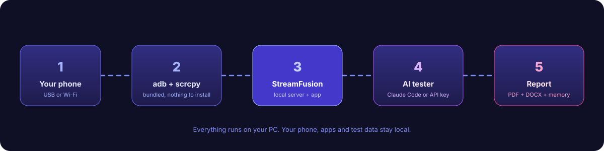
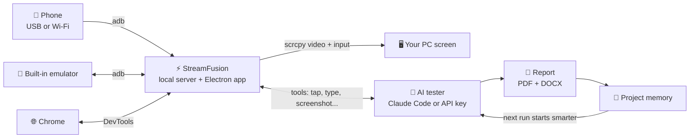

<div align="center">



<br/>

[](https://github.com/MilannSharma/StreamFusion/releases/latest)
[](https://github.com/MilannSharma/StreamFusion/releases)
[](https://github.com/MilannSharma/StreamFusion/releases/latest)
[](LICENSE)

[](https://github.com/MilannSharma/StreamFusion)
[](CONTRIBUTING.md)
[](https://github.com/MilannSharma/StreamFusion/labels/good%20first%20issue)
[](https://github.com/MilannSharma/StreamFusion/stargazers)
[](https://github.com/MilannSharma/StreamFusion/issues)
[](https://github.com/MilannSharma/StreamFusion/commits/main)


### **[Download for Windows](https://github.com/MilannSharma/StreamFusion/releases/latest)** &nbsp;·&nbsp; [Features](#-features) &nbsp;·&nbsp; [How it works](#-how-it-works) &nbsp;·&nbsp; [Quick start](#-quick-start) &nbsp;·&nbsp; [Contribute](#-contributing)

</div>

---

## ✨ What is StreamFusion?

StreamFusion puts your Android phone on your PC with very low lag and lets you control it with the mouse and keyboard. On top of that it adds an **Android emulator studio** and an **AI tester** that can test an Android app or a website for you and then write a detailed report.

- **Nothing to set up.** `scrcpy` and `adb` ship inside the installer, so it works on a fresh PC.
- **No cable needed after the first time.** Pair over Wi-Fi with a code, and the phone reconnects by itself.
- **Local first.** Your phone, your apps and your test data stay on your PC.
- **Free and open source** under the MIT license.

<br/>

<div align="center">

</div>

---

## 🚀 Features

Click a section to open it.

<details open>
<summary><b>📱 Mirror and control</b></summary>

<br/>

| | |
| :--- | :--- |
| **Mirror over USB or Wi-Fi** | scrcpy based, 60+ FPS, hardware decoding, audio on Android 11+. |
| **Connect without a cable** | Pair once with a **pairing code** (or QR) on Android 11+, then the phone reconnects on its own, even when its port changes. |
| **One phone, one row** | A phone saved over several Wi-Fi addresses is shown once, under the nickname you gave it. |
| **Fix my connection** | An assistant that really checks adb, USB drivers, network, discovery, the mirror engine and the phone, one step at a time, and offers a fix for what it finds. |
| **Screenshots and recording** | MP4/MKV recording with a built-in recordings gallery. |
| **Files and apps** | Drag and drop files to the phone, drag an `.apk` to install it, browse phone storage. |
| **Clipboard and shortcuts** | Copy and paste between PC and phone, plus a virtual navigation bar. |
| **Background mode** | Optionally stays in the tray, keeps the phone connected and shows phone notifications as Windows notifications. You can turn it off in Settings. |

</details>

<details open>
<summary><b>🧪 Test Apps (Android phone or built-in emulator)</b></summary>

<br/>

- **Pick a device**: your own phone, or the built-in Android 14 emulator that installs from inside the app.
- **Fast emulator**: it saves its state when you turn it off, so the next start resumes in seconds and your installed apps stay. A saving animation shows while it writes.
- **AI chat** that taps, types, scrolls and checks the screen like a person would. Works with the **Claude Code** you already have (no API key) or with an Anthropic API key.
- **Test brief wizard**: project, feature, app, up to three logins, test cases (paste or drop files), PRD and other documents.
- **Persona**: choose who is testing (for example a first-time user) or let the AI pick, and see which one is active.
- **Chat history**: every chat is saved, searchable and can be resumed.
- **Live status pill**: when the chat is hidden, a small pill still shows what the AI is doing in one line.

</details>

<details open>
<summary><b>🌐 Test Websites</b></summary>

<br/>

- Drives Chrome with the same AI chat: navigate, click, fill, check text and URLs, read the console and network.
- Can attach to Chrome or a WebView on the phone.
- Same brief, persona, reports and project memory as app testing.

</details>

<details open>
<summary><b>🧠 Projects and memory</b></summary>

<br/>

- Every project keeps a **context file**, organised **feature by feature**: how to reach it, test data that worked, open issues, fixed issues, tips and the cases already run.
- It **updates after every test run** and is sent to the AI with the next one, so each test starts smarter than the last.
- Compact views: one line per feature, open issues first, details only when you open them. The raw markdown file stays editable.

</details>

<details open>
<summary><b>📄 Reports</b></summary>

<br/>

Branded **PDF and DOCX**, saved automatically to `Downloads\StreamFusion Reports`. Every test case uses the same fixed format:

```
TC-01 · Title
├─ Description
├─ Steps (as actually performed)
├─ Output (what really happened, with a screenshot)
├─ Result  (Pass / Fail / Blocked)
└─ If it failed: how to fix it    ·    If it passed: suggestions
```

Plus: result at a glance, defects by severity, results by feature, coverage (tested and not tested), and suggestions on UX, performance, accessibility and security.

</details>

<details>
<summary><b>🔌 Use it from other AI tools (MCP)</b></summary>

<br/>

StreamFusion also runs as an **MCP server**, so other AI tools can drive the phone, the emulator and the browser, and write reports through the same tools.

</details>

---

## 🧩 How it works



---

## ⚡ Quick start

1. **Download** `StreamFusion-v<version>-Setup.exe` from [Releases](https://github.com/MilannSharma/StreamFusion/releases/latest) and run it. The app updates itself later.
2. **Connect your phone** (first time only, pick one):
   - **Cable**: enable *USB debugging* (Settings, About phone, tap *Build number* 7 times, Developer options, USB debugging), plug in and tap *Allow*.
   - **No cable (Android 11+)**: on the phone open *Developer options, Wireless debugging, Pair device with pairing code*. In StreamFusion click **Connect without cable** and enter the code. The code appears on the phone screen.
3. Click **Mirror**, or open **Test Apps** and choose your phone.

> 💡 If a pairing screen shows no QR option (Android 12 and some brands), use the **pairing code**. Do not scan the QR with the normal camera app: it only sees a Wi-Fi network.

For AI testing install [Claude Code](https://claude.com/claude-code) and sign in from the AI chat, or paste an Anthropic API key in its settings.

<details>
<summary><b>⌨️ Keyboard and mouse shortcuts</b></summary>

<br/>

| Action | Shortcut |
| :--- | :--- |
| Wake phone | Double click, or `Alt` + `P` |
| Fullscreen | `Alt` + `F` |
| Back | `Alt` + `B` or right click |
| Home | `Alt` + `H` or middle click |
| Recents | `Alt` + `S` |
| Phone screen off / on | `Alt` + `O` / `Alt` + `Shift` + `O` |
| Volume | `Alt` + `Up` / `Down` |
| Notifications / quick settings | `Alt` + `N` / `Alt` + `Shift` + `N` |
| Copy phone clipboard | `Alt` + `C` |
| Paste to phone | `Ctrl` + `V` |

</details>

<details>
<summary><b>🛠️ Troubleshooting</b></summary>

<br/>

| Problem | What to do |
| :--- | :--- |
| Phone not found | Open **Fix my connection**. It checks each step and offers a fix. |
| Phone says *unauthorized* | Unlock it and tap **Allow** on the USB debugging box. Still nothing: *Developer options, Revoke USB debugging authorizations*, then replug. |
| Wi-Fi phone stays offline | PC and phone must be on the same Wi-Fi (guest Wi-Fi and hotspots count as different). Switch Wireless debugging off and on. |
| Black mirror | The phone screen is off. Wake it, or use **Fix my connection**. |
| Emulator will not start | It repairs itself once automatically. If it still fails, use *Factory reset* (erases emulator data). |

</details>

---

## 🏗️ Build from source

Requirements: Windows 10/11, Node.js 20+, Git.

```bash
git clone https://github.com/MilannSharma/StreamFusion.git
cd StreamFusion
npm install
npm run dev          # server + Vite + Electron
npm test             # unit tests
npm run build:exe    # type-check, tests, then the Windows installer in release/
```

<details>
<summary><b>📁 Project layout</b></summary>

<br/>

```
electron/    main process, tray, auto-updater, preload
server/      Express backend: device, wifi pairing, emulator, web, agent (chat, batch, prompts),
             automation, test reports, projects and memory, diagnostics, MCP server
src/         React 19 UI (Test Apps, Test Websites, AI chat, test brief, projects, guide)
public/      icons, fonts, animations
scrcpy-bin/  bundled scrcpy and adb
docs/assets/ README artwork
scripts/     dev and version helper scripts
```

</details>

---

## 🤝 Contributing

StreamFusion is open source and contributions are welcome: bug reports, ideas, docs and code.

1. Read [CONTRIBUTING.md](CONTRIBUTING.md).
2. Pick an issue (look for **good first issue**) or open one to discuss your idea.
3. Fork, create a branch, make your change, run `npm test`, open a pull request.

Please follow the [Code of Conduct](CODE_OF_CONDUCT.md). To report a security problem privately, see [SECURITY.md](SECURITY.md).

## 🗺️ Roadmap

- [x] Wi-Fi pairing without a cable
- [x] Project memory that updates after every test
- [x] Fast emulator with saved state
- [ ] macOS and Linux builds
- [ ] Screenshot comparison to catch visual changes between runs
- [ ] Automated accessibility checks on web pages
- [ ] iOS support (research)

Have an idea? [Open a feature request](https://github.com/MilannSharma/StreamFusion/issues/new?template=feature_request.md).

## ⭐ Support the project

If StreamFusion saves you time, a **star** on GitHub helps other people find it, and sharing it with a friend helps even more.

## 🙏 Credits and license

Developed by [Milann Sharma](https://github.com/MilannSharma). Built on [scrcpy](https://github.com/Genymobile/scrcpy) (Genymobile) and Android Debug Bridge (AOSP). Released under the [MIT License](LICENSE).

<div align="center">
<sub>Made with care for people who test and build Android apps.</sub>
</div>
